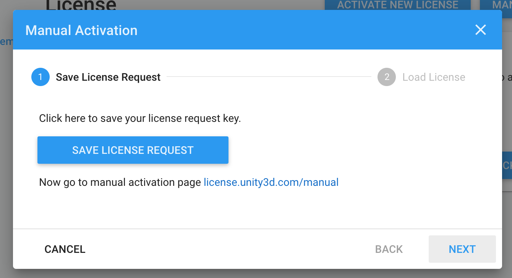
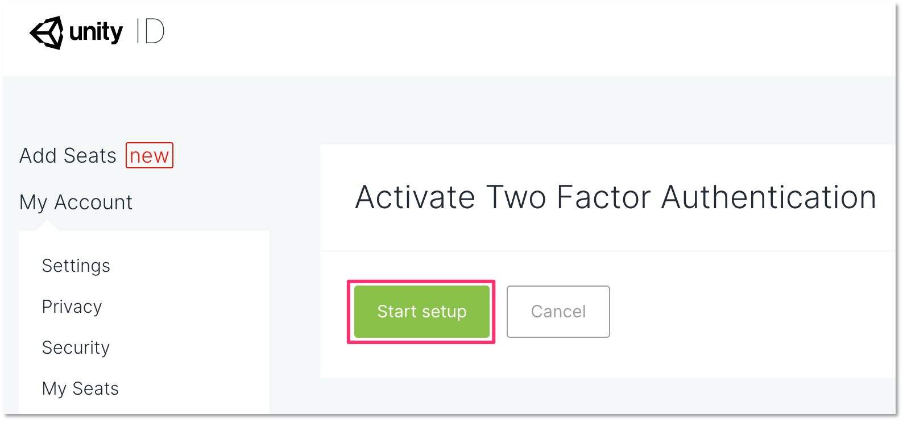
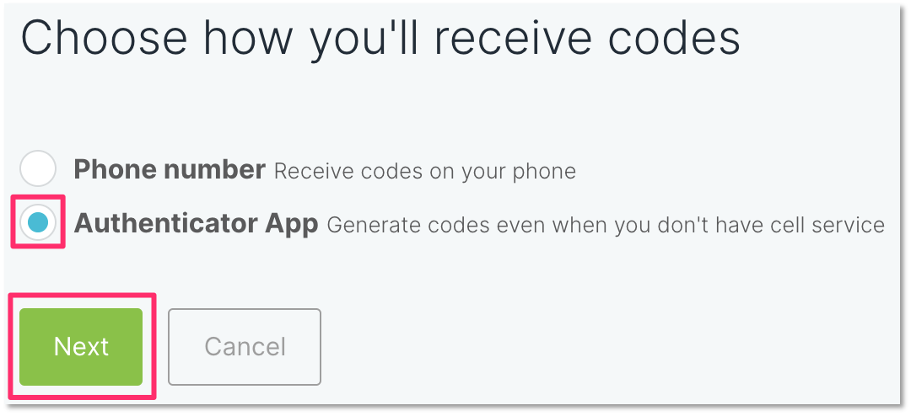
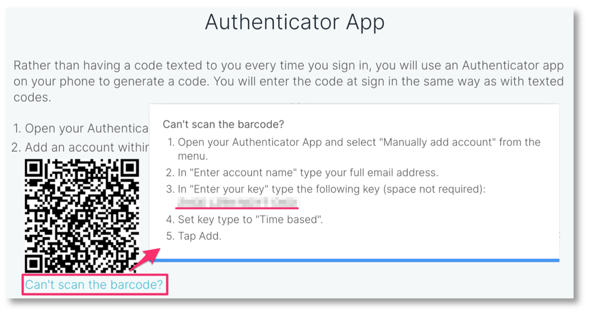
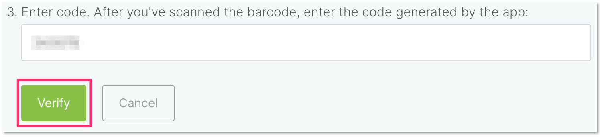
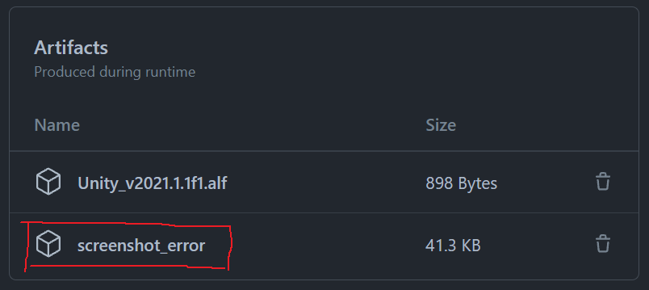

[](https://opensource.org/licenses/Apache-2.0)
[](https://github.com/jcs090218/unity-license-activate/releases/latest)
[](https://www.npmjs.com/package/unity-license-activate)
[](https://npmcharts.com/compare/unity-license-activate?minimal=true)
[](https://npmcharts.com/compare/unity-license-activate?minimal=true)

# unity-license-activate
> A tool to automate the manual activation of unity license using puppeteer

[](https://github.com/game-ci/unity-license-activate/actions/workflows/test.yml)

This is a fork from [MizoTake/unity-license-activate](https://github.com/MizoTake/unity-license-activate).

This tool is design to use with [GameCI](https://game.ci/) and personal license
(free version) users. Personal license will expire after some times, then you most
likely would have to repeast the step [Activation - Personal License](https://game.ci/docs/github/activation#personal-license)
in order to keep the CI running. Thankfully, you can use this tool to constantly
activate a new license from Unity's licensing system.

<p align="center">
  
</p>

## 🔨 How to use?

You can use this tools with any CI/CD system as long as you have the [Node](https://nodejs.org/en/)
environment set up! Here is an example for GitHub Actions.

It needs Node.js 22.12 or newer.

```yml
jobs:
  acquire_ulf:
    name: Acquire .ulf file 🔑
    runs-on: ubuntu-latest
    steps:
      - name: Set up Node.js
        uses: actions/setup-node@v6
        with:
          node-version: 24

      - name: Install node package, `unity-license-activate`
        run: npm install --global unity-license-activate

      - name: Activate the license
        run: unity-license-activate "${{ secrets.UNITY_EMAIL }}" "${{ secrets.UNITY_PASSWORD }}" "${{ needs.request_alf.outputs.alf }}"

      - name: Read ulf
        id: ulfRead
        uses: juliangruber/read-file-action@v1.1.4
        with:
          path: ${{ env.ULF_FILE }}

      - name: Update secret UNITY_LICENSE
        uses: hmanzur/actions-set-secret@v2.0.0
        with:
          name: 'UNITY_LICENSE'
          value: '${{ steps.ulfRead.outputs.content }}'
          token: ${{ secrets.ACCESS_TOKEN }}
```

See the full example [here](https://github.com/jcs090218/JCSUnity/blob/master/.github/workflows/license.yml).

## 🔐 Two Factor Authentication (TFA)
Unity requires you to enter a 6 digit verification code when signing in.
This project supports two types of verification code:

#### Authenticator App (TOTP)
Authenticator App is the preferred option when TFA is explicitly enabled on an account.
To get past this, specify your original authenticator key and `unity-license-activate` will generate a TOTP automatically.

```yml
      - name: Activate the license
        run: unity-license-activate ... --authenticator-key "${{ secrets.UNITY_TOTP_KEY }}"
```

#### How to obtain authenticator key

- Login to Unity account and activate new two factor authentication.
Go to https://id.unity.com/en/settings/tfa/new and click `Start setup`

- Select `Authenticator App` and click `Next`

- Click `Can't scan the barcode?`.
Find and save the authenticator key

- Verify activation with Google Authenticator. You can also verify using a QR code


#### Email
Email is the default option when you have not enabled TFA on your account: after
signing in, Unity shows a "Security check" page and emails you a verification code.

This tool reads that code from your inbox over IMAP with
[unity-verify-code](https://github.com/game-ci/unity-verify-code), which is installed
along with it. Follow its [prerequisites](https://github.com/game-ci/unity-verify-code#-prerequisite)
to allow IMAP access to your inbox. It currently knows the IMAP servers of Gmail,
Outlook/Hotmail, Yahoo, Foxmail and QQ addresses only.

If your Unity account and your email account have different passwords, pass the
email password with `--email-password`:

```yml
      - name: Activate the license
        run: unity-license-activate ... --email-password "${{ secrets.EMAIL_PASSWORD }}"
```

## ㊙️ Secrets

You should have 3 ~ 4 GitHub secrets to correctly set up the entire workflow.

* `UNITY_EMAIL` - Email address that you use to login to Unity
* `UNITY_PASSWORD` - Password that you use to login to Unity
* `ACCESS_TOKEN` - Use to update secret `UNITY_LICENSE`, see [hmanzur/actions-set-secret#token](https://github.com/hmanzur/actions-set-secret#token)
* `EMAIL_PASSWORD` (optional) - Use to get pass Unity's Two Factor Authentication,
`UNITY_PASSWORD` is used by default assuming your passwords are the same.
* `UNITY_TOTP_KEY` (optional) - Use to pass Unity's Two Factor Authentication,

## 🩺 Error handling

For some reason, if this plugin does not work. Try configure your workflow file
like this,

```yml
      - name: Activate the license
        run: unity-license-activate "${{ secrets.UNITY_EMAIL }}" "${{ secrets.UNITY_PASSWORD }}" "${{ needs.request_alf.outputs.alf }}"

      # Add the error handling step here!
      - name: 🩺 Upload error screenshot
        if: failure()
        uses: actions/upload-artifact@v7
        with:
          name: screenshot_error
          path: error.png
```

The program generates a `error.png` file if something went wrong. Then you can
download and see what's the last step before the program is exited. It also logs a
short summary of the page (field names, button labels, no values) to the job log.

> **Note:** artifacts of public repositories can be downloaded by anyone, and the
> screenshot may show your account's email address. Upload it only from private
> repositories, or rely on the logged page summary instead.

<p align="center">
  
</p>

## 📇 Command Line Arguments

```console
usage : unity-license-activate EMAIL [EMAIL ...] PASSWORD [PASSWORD ...] ALF [ALF ...]

Unity License Activate : Activate Unity license through CLI.

positional arguments:
  EMAIL          Username or Email you use to register for Unity account
  PASSWORD       Password to login Unity account
  ALF            Unity activation license file path
```

## 🔗 Links

- https://license.unity3d.com/manual

## ⚜️ License

This repository is [Apache 2.0](./LICENSE) licensed.

This includes all contributions from the community.
